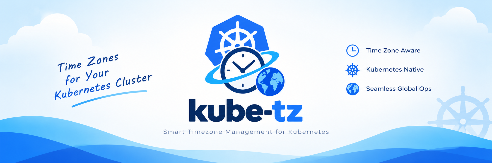

# kube-tz — Kubernetes Timezone Injector

<!-- Replace YOUR_ORG with your GitHub organisation/user. Add CI badges once workflows exist. -->

[](./LICENSE)
[](https://kubernetes.io/docs/reference/access-authn-authz/mutating-admission-policy/)
[](./charts/kube-tz)
[](#project-status)
[](./CONTRIBUTING.md)


**kube-tz** makes every Pod in your cluster run in the timezone you choose — automatically, with **no webhook server,
no certificates and no extra Pods to operate.**

It is a Helm chart that installs a Kubernetes
[`MutatingAdmissionPolicy`](https://kubernetes.io/docs/reference/access-authn-authz/mutating-admission-policy/)
(declarative, CEL-based admission that runs *inside* the API server) which adds the timezone to Pods as they are created.

Containers don't inherit the host's timezone. Most images default to UTC, many ship without any timezone data at all,
and the result is logs, schedules and `date` output that disagree from one workload to the next. kube-tz standardises
this cluster-wide, with a simple per-Pod override.

---

## Table of contents

- [Features](#features)
- [Quick start](#quick-start)
- [Architecture](#architecture)
  - [Components](#components)
  - [Request lifecycle](#request-lifecycle)
  - [Decision flow](#decision-flow)
  - [What gets injected](#what-gets-injected)
- [Annotations](#annotations)
- [Configuration](#configuration)
- [Injection strategies](#injection-strategies)
- [Security model](#security-model)
- [Compatibility](#compatibility)
- [How kube-tz compares](#how-kube-tz-compares)
- [Limitations](#limitations)
- [Repository layout](#repository-layout)
- [Building the image](#building-the-image)
- [Development and testing](#development-and-testing)
- [Roadmap](#roadmap)
- [Project status](#project-status)
- [Contributing](#contributing)
- [Security policy](#security-policy)
- [License](#license)
- [Acknowledgements](#acknowledgements)

---

## Features

⚡ **Webhook-free.** Uses the native `MutatingAdmissionPolicy` API — no controller Pod, TLS certificates, `caBundle`
rotation, Service or network hop in the Pod creation path.

⚡ **One timezone for the whole cluster**, set with a single Helm value, and a per-Pod override annotation.

⚡ **Works with any image**, including `scratch` and distroless images that contain no timezone data. The tz database
is delivered by a tiny init container, so nodes and application images need nothing installed.

⚡ **Standardised tzdata version.** Every Pod gets the same IANA tz database release (tracked by the image tag), not
whatever each base image happened to bundle.

⚡ **Safe to combine with your own settings.** Existing `TZ` variables and existing mounts at `/etc/localtime` or
`/usr/share/zoneinfo` are never overwritten, and injection is idempotent under admission reinvocation.

⚡ **Flexible targeting.** Include or exclude namespaces by name, or select them by label. Opt single Pods out with an
annotation.

⚡ **Hardened by default.** The init container runs as a non-root user with a read-only root filesystem, all
capabilities dropped and a `RuntimeDefault` seccomp profile — compatible with the Pod Security `restricted` profile.

⚡ **Input validation.** Timezone names from annotations are validated (no path traversal, length-limited) before they
reach a file path.

⚡ **Observable.** Every injected Pod is annotated with the outcome (`injected` or `skipped-invalid-timezone`) and the
timezone that was used.

⚡ **Optional hostPath mode** for clusters that prefer the node's own tz database.

---

## Quick start

> Requires Kubernetes **1.36+** and Helm 3. See [Compatibility](#compatibility) for older clusters.

**1. Build and push the image** that carries the tz database (once):

```bash
docker build -t <your-registry>/kube-tz:2026e .
docker push <your-registry>/kube-tz:2026e
```

**2. Install the chart:**

```bash
helm install kube-tz ./charts/kube-tz \
  --namespace kube-tz --create-namespace \
  --set timezone=Europe/London \
  --set image.repository=<your-registry>/kube-tz \
  --set image.tag=2026e
```

**3. Try it:**

```bash
kubectl run tz-test --image=busybox:1.37 --restart=Never -- sleep 3600
kubectl exec tz-test -- date                  # prints GMT/BST
kubectl get pod tz-test -o jsonpath='{.metadata.annotations}{"\n"}'
kubectl delete pod tz-test
```

Once the chart is published you will be able to install it straight from a repository:

```bash
helm repo add kube-tz https://YOUR_ORG.github.io/kube-tz/
helm install kube-tz kube-tz/kube-tz --set timezone=Europe/London
```

Full installation, values and troubleshooting guide: **[charts/kube-tz/README.md](./charts/kube-tz/README.md)**.

---

## Architecture

### Components
| Component | Kind | Scope | Responsibility |
|---|---|---|---|
| **kube-tz policy** | `MutatingAdmissionPolicy` | Cluster | Decides whether and how to mutate a Pod, resolves and validates the timezone, produces the patches |
| **kube-tz binding** | `MutatingAdmissionPolicyBinding` | Cluster | Activates the policy and limits it to the selected namespaces |
| **kube-tz init container** | Container (added to Pods) | Pod | Validates the zone exists and copies the tz database into the shared volume |
| **kube-tz volume** | `emptyDir` (added to Pods) | Pod | Shares the tz database between the init container and app containers |
| **kube-tz image** | OCI image | Registry | Carries the IANA tz database and a minimal `sh` + `cp` |

There is **no long-running component**. After `helm install`, the only things that exist are two cluster-scoped API
objects; the API server evaluates them itself.

### What gets injected

Given this Pod:

```yaml
apiVersion: v1
kind: Pod
metadata:
  name: web
spec:
  containers:
    - name: nginx
      image: nginx:alpine
```

kube-tz admits it as (abridged):

```yaml
metadata:
  annotations:
    kube-tz.io/status: injected
    kube-tz.io/injected-timezone: Europe/London
spec:
  initContainers:
    - name: kube-tz                      # inserted first, runs before anything else
      image: <your-registry>/kube-tz:2026e
      env:
        - { name: TIMEZONE, value: Europe/London }
        - { name: ZONEINFO_SRC, value: /opt/tzdata/usr/share/zoneinfo }
      volumeMounts:
        - { name: kube-tz, mountPath: /work }
  containers:
    - name: nginx
      image: nginx:alpine
      env:
        - { name: TZ, value: Europe/London }
      volumeMounts:
        - { name: kube-tz, mountPath: /usr/share/zoneinfo, readOnly: true }
        - { name: kube-tz, mountPath: /etc/localtime, subPath: Europe/London, readOnly: true }
  volumes:
    - name: kube-tz
      emptyDir: { sizeLimit: 32Mi }
```

Why all three pieces? `TZ` is honoured by most runtimes, `/etc/localtime` by libc and many tools, and a full
`/usr/share/zoneinfo` lets runtimes that look up zones by name (Go, Java, Python, …) work even in images with no
tz data.

---

## Annotations

Annotations on a **Pod** (for Deployments and other workloads, set them on the *Pod template*) control the behaviour.
The keys are configurable in the chart values.

| Annotation | Direction | Description | Default |
|---|---|---|---|
| `kube-tz.io/name` | you → kube-tz | Timezone for this Pod, e.g. `Asia/Tokyo` | chart `timezone` |
| `kube-tz.io/inject` | you → kube-tz | Set to `disabled` to skip this Pod | injected |
| `kube-tz.io/status` | kube-tz → you | `injected` or `skipped-invalid-timezone` | — |
| `kube-tz.io/injected-timezone` | kube-tz → you | The timezone that was requested / used | — |

Example:

```yaml
spec:
  template:
    metadata:
      annotations:
        kube-tz.io/name: America/New_York
```

---

## Configuration

The most common settings (the complete, documented list is in the
[chart README](./charts/kube-tz/README.md#values-reference)):

| Value | Description | Default |
|---|---|---|
| `timezone` | Cluster-wide default timezone | `Asia/Kolkata` |
| `image.repository` / `image.tag` | Image with the tz database | `quay.io/kube-tz/kube-tz` / `""` |
| `image.pullSecrets` | Pull secrets for private registries | `[]` |
| `namespaces.exclude` | Namespaces that are never injected | `["kube-system"]` |
| `namespaces.include` | Only inject into these namespaces (empty = all) | `[]` |
| `namespaces.selector` | Label selector, replaces include/exclude | `{}` |
| `policy.failurePolicy` | `Fail` rejects Pods if the policy errors, `Ignore` lets them through | `Fail` |
| `policy.validateTimezone` | Reject malformed timezone names (keep enabled) | `true` |
| `injectIntoInitContainers` | Also inject into the workload's own init containers | `false` |
| `hostPath.enabled` | Copy the tz database from the node instead of the image | `false` |

Example `my-values.yaml`:

```yaml
timezone: UTC
image:
  repository: registry.example.com/platform/kube-tz
  tag: ""
  pullSecrets: [regcred]
namespaces:
  exclude: [kube-system, monitoring]
```

---

## Injection strategies

Container runtimes only know the timezone if `/etc/localtime` points at a valid
[TZif](https://datatracker.ietf.org/doc/html/rfc8536) file (and/or `TZ` is set). Most images don't ship those files, so
kube-tz has to make them available.

| Strategy | How | When to use | Status |
|---|---|---|---|
| **Init container** (default) | An init container copies the tz database from the kube-tz image into a shared `emptyDir`; app containers mount it | Almost always: nothing is required on nodes, works under strict Pod Security | ✅ Available |
| **hostPath** | The node's `/usr/share/zoneinfo` is mounted and copied by the init container | You want the OS-patched tz data from nodes and your namespaces allow `hostPath` volumes | ✅ Available (`hostPath.enabled=true`) |
| **imageVolume** | Mount the tz data straight from an OCI image volume, no copy step | Future option once `/etc/localtime` can be provided without an extra copy | 🧭 Under evaluation |

> `hostPath` volumes are rejected by the Pod Security `baseline` and `restricted` profiles. Use hostPath mode only in
> namespaces that enforce `privileged` (or no enforcement).

---

## Security model

| Area | What kube-tz does |
|---|---|
| **Privileges to install** | Cluster-admin (cluster-scoped policy and binding). At runtime nothing holds any credentials — there is no workload with a ServiceAccount |
| **Attack surface** | No network listener, no webhook endpoint, no TLS material. The policy is evaluated in the API server process |
| **Untrusted input** | The only user-controlled input is the `kube-tz.io/name` annotation. It is length-limited and matched against a strict pattern; **dots are rejected**, so `..` can't reach the file path. Values are passed to the init container as environment variables, never interpolated into the shell command |
| **Init container** | `runAsNonRoot`, UID/GID `65532`, read-only root filesystem, `allowPrivilegeEscalation: false`, `drop: [ALL]`, `seccompProfile: RuntimeDefault`, small CPU/memory limits |
| **Image** | Built `FROM scratch` with a static `busybox` providing only `sh` and `cp`, plus the tz database. Optional SHA-256 verification of the downloaded tz tarball at build time |
| **Failure behaviour** | `failurePolicy: Fail` (default) rejects Pods if the policy itself errors; set `Ignore` to fail open. An invalid timezone name never blocks a Pod — it is skipped and annotated |
| **Idempotency** | Safe under `reinvocationPolicy: IfNeeded`; the same Pod is never injected twice |

Please report vulnerabilities privately — see the [security policy](#security-policy).

---

## Compatibility

| Kubernetes | Support |
|---|---|
| **1.36+** | ✅ Supported — `MutatingAdmissionPolicy` is GA (`admissionregistration.k8s.io/v1`) |
| 1.34 – 1.35 | ⚠️ Beta API, off by default. Enable the `MutatingAdmissionPolicy` feature gate and the beta API, install with `--set policy.apiVersion=admissionregistration.k8s.io/v1beta1`, and relax `kubeVersion` in `Chart.yaml`. Not covered by CI |
| < 1.34 | ❌ Not supported (consider a webhook-based injector — see below) |

| Item | Support |
|---|---|
| Helm | 3.x |
| Pod OS | Linux only (Windows Pods are skipped) |
| Architectures | Whatever you build the image for (`linux/amd64`, `linux/arm64` with `docker buildx`) |
| Managed Kubernetes | Any distribution that exposes the GA API (for managed services, check that the provider has rolled out 1.36) |

---

## How kube-tz compares

There are good webhook-based tools for this problem, for example
[**k8tz**](https://github.com/k8tz/k8tz), which also ships a CLI and supports very old clusters. kube-tz takes a different
approach: use the API server's built-in policy engine and keep the footprint minimal.

| | **kube-tz** | Webhook-based injectors (e.g. k8tz) |
|---|---|---|
| Admission mechanism | `MutatingAdmissionPolicy` (CEL, in-process) | Mutating admission webhook (separate Deployment) |
| Pods / certificates to run | None | Controller Pods, serving certificate and `caBundle` lifecycle |
| Availability of Pod creation | Not coupled to a webhook's uptime | Depends on the webhook's availability and `failurePolicy` |
| Minimum Kubernetes | **1.36** (GA) | Much older clusters (see each project) |
| Standalone CLI for injecting YAML | Not available | Available in some tools |
| Namespace-level annotation inheritance | Not yet (use binding selectors; see roadmap) | Available in some tools |
| Pod Security | Init container fits `restricted`; hostPath mode does not | Similar considerations |

**Choose kube-tz** if you run Kubernetes 1.36+ and prefer fewer moving parts. **Choose a webhook-based tool** if you
must support older clusters or need its CLI/annotation inheritance features today.

---

## Limitations

- Only **new** Pods are affected. Pod specs are immutable, so existing Pods keep their settings until recreated
  (use `kubectl rollout restart` for workloads).
- It sets the timezone **inside Pods**. It does not change a CronJob's schedule timezone (`spec.timeZone`).
- Applications that ignore `TZ` and `/etc/localtime` need their own setting (for example the JVM's `-Duser.timezone`).
- Needs Kubernetes 1.36+ (see [Compatibility](#compatibility)).
- The init container image must be pullable from every injected namespace (use `image.pullSecrets` for private
  registries).
- Pods in `baseline`/`restricted` Pod Security namespaces cannot use hostPath mode.
- A syntactically valid but non-existent zone name (a typo) makes the init container fail and the Pod stay in
  `Init:Error` — by design, so mistakes are loud.

---

## Repository layout

```
kube-tz/
├── README.md                     # this file
├── Dockerfile                    # tz database + sh/cp image used by the init container
├── charts/
│   └── kube-tz/
│       ├── Chart.yaml
│       ├── values.yaml
│       ├── README.md             # install guide, full values reference, troubleshooting
│       └── templates/
│           ├── _helpers.tpl      # names, labels and reusable CEL snippets
│           └── policy.yaml       # MutatingAdmissionPolicy + MutatingAdmissionPolicyBinding
├── docs/                         # (planned) design notes, ADRs
├── .github/workflows/            # (planned) CI: lint, template, kind e2e, image build
├── CONTRIBUTING.md               # (planned)
├── SECURITY.md                   # (planned)
├── CODE_OF_CONDUCT.md            # (planned)
├── CHANGELOG.md                  # (planned)
└── LICENSE                       # (add your license)
```

---

## Building the image

```bash
# Default: tz database release 2026e
docker build -t <your-registry>/kube-tz:2026e .

# Pin the tarball checksum and choose the tz release
docker build \
  --build-arg tzdbversion=2026e \
  --build-arg tzdbsha256=<sha256-of-tzdb-2026e.tar.lz> \
  -t <your-registry>/kube-tz:2026e .

# Multi-architecture
docker buildx build --platform linux/amd64,linux/arm64 \
  -t <your-registry>/kube-tz:2026e --push .
```

| Build arg | Default | Description |
|---|---|---|
| `tzdbversion` | `2026e` | IANA tz database release |
| `tzdbsha256` | *(empty)* | Verify the downloaded tarball when set |
| `REDO` | `posix_only` | `posix_only` ships only the standard tree; `posix_right` also ships leap-second `right/` data |
| `ALPINE_VERSION` | `3.24` | Alpine version used in the build stage |

Keep the **image tag equal to the tz database version**; bump both when IANA publishes a new release.

---

## Development and testing

Prerequisites: Helm 3, `kubectl`, Docker, and a Kubernetes **1.36+** cluster (for example
[kind](https://kind.sigs.k8s.io/) with a 1.36+ node image).

```bash
# 1. Static checks
helm lint charts/kube-tz --kube-version 1.36.0
helm template kube-tz charts/kube-tz --kube-version 1.36.0 --set timezone=Asia/Shanghai | less

# 2. Server-side validation of the rendered policy (type-checks all CEL expressions)
helm template kube-tz charts/kube-tz --kube-version 1.36.0 | kubectl apply --dry-run=server -f -

# 3. Install on a test cluster
helm install kube-tz charts/kube-tz -n kube-tz --create-namespace \
  --set timezone=Asia/Shanghai \
  --set image.repository=<your-registry>/kube-tz --set image.tag=2026e

# 4. Smoke test
kubectl run tz-test --image=busybox:1.37 --restart=Never -- sleep 3600
kubectl wait --for=condition=Ready pod/tz-test --timeout=60s
kubectl exec tz-test -- date                         # expect CST
kubectl get pod tz-test -o jsonpath='{.metadata.annotations}{"\n"}'
kubectl delete pod tz-test
```

Test matrix worth covering in CI (planned): default timezone, per-Pod override, `kube-tz.io/inject: disabled`,
invalid name (`..`), unknown name (`Asia/Nowhere`), Pod with existing `TZ`, Pod with existing `/etc/localtime`
mount, Pod with and without init containers, `injectIntoInitContainers=true`, namespace include/exclude/selector,
hostPath mode, and re-invocation.

---

## Roadmap

> Items below are proposals, not commitments. Open an issue to discuss or vote on priorities.

**Done**

- [X] `MutatingAdmissionPolicy`-based injection (no webhook)
- [X] Cluster-wide default timezone and per-Pod override annotation
- [X] Per-Pod opt-out annotation
- [X] Namespace include / exclude / label selector targeting
- [X] Hardened init container (Pod Security `restricted` compatible)
- [X] Timezone name validation and status annotations
- [X] Optional hostPath mode with tolerance for dangling symlinks
- [X] Optional injection into workload init containers
- [X] Minimal `scratch`-based image with pinned tz database version

**Next**

- [ ] `values.schema.json` for early, readable validation of values
- [ ] `CONTRIBUTING.md`, `SECURITY.md`, issue and PR templates
- [ ] Namespace-level default timezone (e.g. a Namespace annotation read by the policy)
- [ ] Companion `ValidatingAdmissionPolicy` to reject unknown/invalid timezone annotations at admission
- [ ] Automated tz database updates (scheduled workflow that rebuilds and re-tags the image on new IANA releases)
- [ ] Signed images, SBOM and build provenance (cosign / SLSA)
- [ ] Evaluate an `imageVolume` strategy to avoid the copy step
- [ ] Optional parameterised configuration (`paramKind`) for per-namespace policy settings
- [ ] Prebuilt dashboards/alerts guidance for admission errors

**Out of scope (for now)**

- Windows containers
- Changing CronJob schedule timezones
- Mutating existing Pods in place (Kubernetes does not allow it)

---

## Project status

kube-tz is **pre-1.0** (chart `0.1.0`). Values and behaviour may change between minor versions until 1.0; breaking
changes will be listed in the changelog. It is suitable for evaluation and non-critical clusters today — please test
it in a staging cluster, starting with `policy.failurePolicy=Ignore` if you want a gentle rollout.

---

## Contributing

Contributions are very welcome — bug reports, documentation fixes, tests and features.

1. Open an issue to discuss larger changes.
2. Fork, create a branch, and make your change.
3. Run the checks in [Development and testing](#development-and-testing).
4. Open a pull request describing what changed and how you tested it.

Please be kind and constructive; a `CODE_OF_CONDUCT.md` (Contributor Covenant) will accompany the first release.

## Security policy

Please **do not** open public issues for security problems. Report them privately through GitHub's
*Security → Report a vulnerability* feature on this repository (or the contact in `SECURITY.md` once added).

## License

Released under the **Apache License 2.0** — see [LICENSE](./LICENSE). <!-- Change if you choose another license. -->

## Acknowledgements

- The [Kubernetes SIG API Machinery](https://github.com/kubernetes/community/tree/master/sig-api-machinery) community
  for `MutatingAdmissionPolicy` and CEL admission.
- [**k8tz**](https://github.com/k8tz/k8tz), the webhook-based timezone controller whose clear documentation and
  injection-strategy concepts inspired this project.
- The [IANA Time Zone Database](https://www.iana.org/time-zones) and its maintainers.